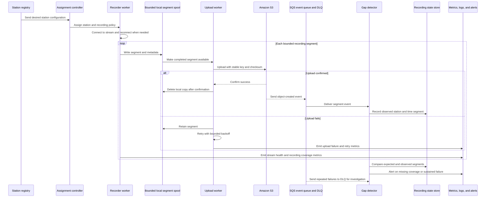

# Radio Recording Platform — Production-Optimized Architecture

> **Target design:** This architecture evolves the current prototype into a production platform for real radio-stream capture. It is a recommendation, not a description of deployed infrastructure.

## 1. AWS network and platform architecture

```mermaid
flowchart TB
    Radio["External radio stream providers"]
    GitHub["GitHub repository"]
    User["Platform operators"]

    subgraph AWS["AWS account · production environment · eu-west-2"]
        subgraph VPC["Production VPC · multi-AZ"]
            IGW["Internet Gateway"]

            subgraph AZA["Availability Zone A"]
                PubA["Public subnet A<br/>public load balancers / egress"]
                NAT_A["NAT Gateway A"]
                PrivA["Private application subnet A<br/>EKS worker capacity"]
                IsolatedA["Isolated data subnet A<br/>private endpoints / data services as needed"]
            end

            subgraph AZB["Availability Zone B"]
                PubB["Public subnet B<br/>public load balancers / egress"]
                NAT_B["NAT Gateway B"]
                PrivB["Private application subnet B<br/>EKS worker capacity"]
                IsolatedB["Isolated data subnet B<br/>private endpoints / data services as needed"]
            end

            subgraph AZC["Availability Zone C"]
                PubC["Public subnet C<br/>public load balancers / egress"]
                NAT_C["NAT Gateway C"]
                PrivC["Private application subnet C<br/>EKS worker capacity"]
                IsolatedC["Isolated data subnet C<br/>private endpoints / data services as needed"]
            end

            subgraph EKS["Amazon EKS · private worker plane"]
                ControlPlane["AWS-managed EKS control plane<br/>private API endpoint preferred"]
                Ingress["Internal ingress / Kubernetes services"]
                Controller["Station assignment controller"]
                Workers["Recorder worker pool<br/>spread across AZs<br/>autoscaled by station demand"]
                Uploader["Segment validation and upload workers"]
                ObservabilityAgent["Cluster telemetry agents"]

                Controller --> Workers
                Workers --> Uploader
                Workers --> ObservabilityAgent
                Uploader --> ObservabilityAgent
                ControlPlane <-->|"Kubernetes API"| Controller
                ControlPlane <-->|"Kubernetes API"| Workers
                Ingress -. "internal management APIs, if required" .-> Controller
            end

            VPCEndpoints["VPC endpoints<br/>S3 · ECR API/DKR · STS<br/>CloudWatch Logs · KMS · Secrets Manager"]
            Egress["Controlled outbound egress<br/>NAT per AZ; optional egress firewall/proxy"]

            PrivA --> NAT_A
            PrivB --> NAT_B
            PrivC --> NAT_C
            NAT_A --> IGW
            NAT_B --> IGW
            NAT_C --> IGW

            PrivA --> VPCEndpoints
            PrivB --> VPCEndpoints
            PrivC --> VPCEndpoints

            Workers -->|"radio stream connections"| Egress
            Uploader --> VPCEndpoints
            Egress --> NAT_A
            Egress --> NAT_B
            Egress --> NAT_C

            PrivA --- IsolatedA
            PrivB --- IsolatedB
            PrivC --- IsolatedC
            PubA --- IGW
            PubB --- IGW
            PubC --- IGW
        end

        subgraph DataServices["AWS managed services"]
            ECR["Amazon ECR<br/>immutable, scanned images"]
            S3["Amazon S3 recordings bucket<br/>SSE-KMS · versioning<br/>lifecycle and retention policies"]
            Queue["Amazon SQS segment-event queue<br/>retry policy and dead-letter queue"]
            RegistryDB["Station registry and recording state<br/>DynamoDB or managed database"]
            Secrets["AWS Secrets Manager / Parameter Store"]
            KMS["AWS KMS keys"]
            Metrics["Amazon Managed Prometheus<br/>or managed metrics backend"]
            Dashboards["Amazon Managed Grafana<br/>dashboards and alert views"]
            Logs["Amazon CloudWatch Logs"]
            Alerts["Alerting and notification routing"]
            GapDetector["Gap detection service<br/>scheduled expected-vs-observed checks"]
            Consumers["Downstream processing and analytics"]
        end

        Identity["Workload identity<br/>IRSA or EKS Pod Identity<br/>separate least-privilege roles"]

        Controller -->|"read desired station state"| RegistryDB
        Controller -->|"configuration/secrets references"| Secrets
        Workers -->|"station configuration"| RegistryDB
        Workers -. "AWS access" .-> Identity
        Uploader -. "AWS access" .-> Identity
        Identity --> S3
        Identity --> RegistryDB
        Identity --> Queue

        ECR -. "private endpoint image pulls" .-> Workers
        Uploader -->|"upload completed segments"| S3
        S3 -->|"object-created notification"| Queue
        Queue --> GapDetector
        Queue --> Consumers
        GapDetector -->|"expected/observed status"| RegistryDB
        GapDetector --> Alerts

        KMS -. "encryption keys" .-> S3
        KMS -. "encryption keys" .-> Secrets

        ObservabilityAgent --> Metrics
        ObservabilityAgent --> Logs
        Metrics --> Dashboards
        Metrics --> Alerts
        Logs --> Alerts
    end

    subgraph Delivery["Build and deployment"]
        CI["GitHub Actions CI<br/>tests · Terraform validation<br/>security and image scans"]
        Publish["Publish versioned image to ECR<br/>using short-lived AWS identity"]
        GitOps["In-cluster GitOps controller<br/>pulls approved deployment config"]
        GitHub --> CI --> Publish
        Publish --> ECR
        GitHub -->|"deployment configuration"| GitOps
        GitOps -->|"reconcile workloads"| ControlPlane
    end

    User -->|"VPN / approved private access"| ControlPlane
    Radio -->|"outbound stream connections"| Workers
    S3 -->|"recording objects"| Consumers
```

## 2. Recording, delivery, and gap-detection flow

## 3. Network layout and routing

| Network area                          | Production role                                                                                                                                                                                |
| ------------------------------------- | ---------------------------------------------------------------------------------------------------------------------------------------------------------------------------------------------- |
| **Public subnets**              | Internet-facing load balancers only when required, plus one NAT gateway per availability zone. No recorder pods or worker nodes should run here.                                               |
| **Private application subnets** | EKS worker nodes and recorder workloads across three availability zones. Workers reach radio streams through controlled outbound egress.                                                       |
| **Isolated/data subnets**       | Optional placement for private data services that support subnet placement. S3, ECR, SQS, and other AWS managed services are accessed through service endpoints where supported.               |
| **NAT gateways**                | One per AZ for resilient outbound access. Route each private subnet through the NAT gateway in the same AZ to avoid a single-AZ egress dependency and cross-AZ NAT traffic.                    |
| **VPC endpoints**               | Prefer private access for S3, ECR, STS, CloudWatch Logs, KMS, and Secrets Manager where supported and appropriate. Confirm endpoint policies and DNS configuration.                            |
| **EKS API**                     | Prefer a private cluster endpoint. Operators and deployment automation need approved private connectivity; the in-cluster GitOps controller avoids requiring a public inbound deployment path. |
| **Internet Gateway**            | Provides internet connectivity for public-subnet resources and NAT gateways. It should not provide direct inbound access to worker nodes.                                                      |

## 4. Production design choices

- **Availability:** Spread worker capacity across multiple AZs. Use per-AZ egress and preserve enough cluster capacity to tolerate an AZ disruption.
- **Station ownership:** Keep desired station configuration separate from worker execution. The controller reconciles configured stations to healthy worker assignments.
- **Capture isolation:** Isolate failures at station or worker level so an unavailable stream does not stop unrelated stations.
- **Durable delivery:** Write bounded segments to local spool storage and retain them until S3 confirms delivery. Use bounded retries, checksums, and stable object keys to support recovery and duplicate handling.
- **Storage:** Partition objects by station and time. Set lifecycle/retention policies according to business and regulatory needs. Use encryption and narrowly scoped access; consider cross-region replication only where recovery objectives require it.
- **Gap detection:** Track expected versus observed segments in a state store. Treat recording coverage as a business health signal, not just a pod-health metric.
- **Scaling:** Scale worker capacity from active station assignments and measured resource demand; scale the cluster to provide capacity. Validate whether one-worker-per-station or bounded station sharding is more efficient for actual stream and CPU/memory profiles.
- **Security:** Use workload identity and separate least-privilege roles for recorders, uploaders, controllers, and gap detection. Keep secrets out of images and source control.
- **Operations:** Centralize logs, metrics, and alerts. Monitor stream connectivity, recording coverage, upload success/latency, retries, spool utilization, pod restarts, and cluster capacity.
- **Delivery:** Build and scan immutable images in CI, publish to ECR using short-lived credentials, and use an approved GitOps or deployment promotion workflow. Keep production changes reviewable and reversible.
- **Environment separation:** Maintain separate development, staging, and production accounts or equivalent strong environment boundaries, with independent configuration and access controls.

## 5. Scope and assumptions

This is a target design for production implementation. The repository currently provisions a smaller prototype with a VPC, EKS, ECR, S3, IRSA, and a synthetic JSON generator. The station controller, real audio recorder, durable segment spool, event-driven gap detection, production telemetry stack, private EKS API deployment path, and multi-AZ NAT/endpoints shown here are proposed components and require implementation and validation.
